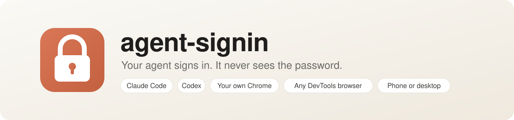

<p align="center">
  <picture>
    <source media="(prefers-color-scheme: dark)" srcset="docs/banner-dark.svg">
    
  </picture>
</p>

<p align="center">
  <a href="#install"></a>
  <a href="https://agentskills.io"></a>
  
  
  <a href="LICENSE"></a>
  <a href="https://github.com/bggoranoff/agent-blindfold/actions/workflows/test.yml"></a>
</p>

<p align="center">
  <a href="#install"><b>Install</b></a> · <a href="#how-it-works"><b>How it works</b></a> · <a href="#security"><b>Security</b></a>
</p>

Let your browser agent sign in to websites, 2FA included, without your password, code or sign-in link ever passing through it.


<sub>A fake site, with the agent and its browser standing in for a server and an emulated iPhone-size browser for the phone. The links are real Cloudflare quick tunnels, with their start-up sped up 4×. The agent's lines are scripted; the commands and their output are real. [MP4](docs/demo-phone.mp4)</sub>

## Why

A browser agent that hits a login today either stops and hands the job back to you, or asks you to paste the password into the chat. A pasted password goes to the model and stays in the transcript, and so does the 2FA code after it. agent-blindfold gets the agent signed in without it ever holding the secret.

## How it works

1. **The agent hits a login** and runs one command, instead of asking you for the password in chat.
2. **You get a one-time link** on your phone, plus a small window if you are at the Mac the agent runs on. Fill either from your password manager.
3. **The script types your answer into the agent's tab itself**, on the site the window names, and submits. The agent only learns which fields were filled.

It is one Node script with no dependencies, packaged as an [Agent Skill](https://agentskills.io) for Claude Code, Codex and other skill-aware agents.

## Install

Paste the prompt for your setup into your agent: Claude Code, Codex or another one with a shell. It installs everything, then runs a test sign-in with you on a public test site.

### Agent in your own Chrome

For an agent on your computer that browses in your everyday Chrome, such as Claude Code with Claude in Chrome. It adds a small companion extension.

<details>
<summary><b>Copy the install prompt</b></summary>

```text
Install agent-blindfold from https://github.com/bggoranoff/agent-blindfold, so you can sign in to websites in my own Chrome without ever seeing my passwords or codes.

1. Check that `node -v` is 22 or later. If it isn't, stop and tell me.
2. Clone the repo to ~/.agent-blindfold, or run `git -C ~/.agent-blindfold pull` if it is already there.
3. Link the skill for Claude Code and Codex: run `mkdir -p ~/.claude/skills ~/.agents/skills`, then `ln -sfn ~/.agent-blindfold/skills/agent-blindfold ~/.claude/skills/agent-blindfold` and the same for ~/.agents/skills.
4. If you are Codex, write this rule to ~/.codex/rules/agent-blindfold.rules, with my real home folder in the path: prefix_rule(pattern = ["node", "<home>/.agent-blindfold/skills/agent-blindfold/signin.mjs"], decision = "allow")
5. Run `node ~/.agent-blindfold/skills/agent-blindfold/signin.mjs install`. Assume my browser is Google Chrome unless I have said otherwise. For another Chromium browser, pass its profile folder in quotes as the argument, such as `install "$HOME/Library/Application Support/BraveSoftware/Brave-Browser"`. Show me the step it prints for loading the extension, and wait until I say I have done it.
6. Test it with me. Open https://the-internet.herokuapp.com/login in my own everyday Chrome, not in a separate browser of yours. Use your Claude in Chrome tool if you have one, or else `open -a "Google Chrome" <url>` on a Mac or `google-chrome <url>` on Linux, with my browser's name if it is another one. Tell me a sign-in window is opening, and that the site's public test login is tomsmith / SuperSecretPassword!. Run `node ~/.agent-blindfold/skills/agent-blindfold/signin.mjs ask --cdp extension --tab the-internet.herokuapp.com`, and show me the `url` it prints in case no window shows up. Then run `node ~/.agent-blindfold/skills/agent-blindfold/signin.mjs wait <id>` with a 10-minute timeout. Its last line must have `"status":"filled"`, and the page must then say "You logged into a secure area!". Tell me whether it worked, and if the status is anything else, the `reason` it gives.
```

</details>

### Agent on a server

For an agent that runs elsewhere and browses in a Chromium with a DevTools port, while you answer from your phone or laptop.

<details>
<summary><b>Copy the install prompt</b></summary>

```text
Install agent-blindfold from https://github.com/bggoranoff/agent-blindfold on this machine, so you can sign in to websites in your browser with logins I enter on my phone, without ever seeing them.

1. Check that `node -v` is 22 or later. If it isn't, install Node 22 or later, or stop and tell me if you can't.
2. Clone the repo to ~/agent-blindfold, or run `git -C ~/agent-blindfold pull` if it is already there. Then link the skill. For Claude Code run `mkdir -p ~/.claude/skills && ln -sfn ~/agent-blindfold/skills/agent-blindfold ~/.claude/skills/agent-blindfold`, and for Codex the same with ~/.agents/skills.
3. If you are Codex, write this rule to ~/.codex/rules/agent-blindfold.rules, with the real home folder in the path: prefix_rule(pattern = ["node", "<home>/agent-blindfold/skills/agent-blindfold/signin.mjs"], decision = "allow")
4. Find your browser's DevTools endpoint: an http:// address where `curl -s <address>/json/version` answers with JSON. Try http://127.0.0.1:9222 first. Otherwise, find the port in the `--remote-debugging-port` flag of the browser's process, or in your browser tool's settings. If several browsers have one, use the one you drive. If it is not 127.0.0.1:9222, set CDP_URL to that http:// address for future sessions, for Claude Code under "env" in ~/.claude/settings.json, creating the file or keeping what is already in it. Pass it on your commands in this session too. If all you have is a wss:// address from a hosted browser service, stop and tell me: that is not supported.
5. Unless SIGNIN_PUBLIC_URL is set, make sure `cloudflared` is installed, from your package manager or https://github.com/cloudflare/cloudflared/releases.
6. Test it with me. Open https://the-internet.herokuapp.com/login in your browser. Run `node ~/agent-blindfold/skills/agent-blindfold/signin.mjs ask --tab the-internet.herokuapp.com`, adding `--tunnel` unless SIGNIN_PUBLIC_URL is set. Send me the `url` it prints, and tell me the site's public test login is tomsmith / SuperSecretPassword!. Then run `node ~/agent-blindfold/skills/agent-blindfold/signin.mjs wait <id>` with a 10-minute timeout. Its last line must have `"status":"filled"`, and the page must then say "You logged into a secure area!". Tell me whether it worked, and if the status is anything else, the `reason` it gives.
```

</details>

In Claude Code you can also install it as a plugin, which suits an agent on a server:

```text
/plugin install agent-blindfold --marketplace bggoranoff/agent-blindfold
```

For your own Chrome, use the prompt above instead. The extension needs a folder that stays put, and a plugin update moves it.

To install by hand:

1. Clone the repo and link `skills/agent-blindfold` into your agent's skills folder.
2. For your own Chrome, run `signin.mjs install`, then load `skills/agent-blindfold/extension` with Load unpacked in `chrome://extensions`.

Otherwise the skill uses the browser your agent already drives, such as Playwright MCP or Browser Use. If that browser's DevTools port is not 9222, set `CDP_URL`.

## Use

The agent learns this from `SKILL.md` and runs it itself:

```sh
$ node signin.mjs ask --tab linkedin.com --tunnel
{"id":"3f9c1e7a2b4d","origin":"https://www.linkedin.com","fields":["username","password"],"status":"waiting","url":"https://….trycloudflare.com/9fK…","expires":…}
$ node signin.mjs wait 3f9c1e7a2b4d
{"origin":"https://www.linkedin.com","fields":["username","password"],"status":"filled","filled":["username","password"]}
```

The last line says `filled`, `failed`, `cancelled` or `expired`, and the exit code is 0 only for `filled`. When there is no link to send first, `ask --wait` does both steps in one call.

| The page asks for | Command |
|---|---|
| An email, username, password or verification code (one box, or one per digit) | `ask` |
| Some characters of a password, such as the 2nd, 5th and 7th | `ask password --characters 2,5,7` |
| A PIN, security answer or memorable word | `ask secret --focused --label "Memorable word"` |
| A box `ask` misses, such as one in another site's frame | `ask <username, password or code> --focused` |
| A sign-in link the site emailed | `ask link` |
| The browser's own login dialog | `ask --dialog <url>` |

`ask` asks for exactly the boxes the page shows, labelled in the site's own words, and pins them. If one is gone or has been swapped by the time you answer, nothing is typed. A site that asks for the email first gets one ask per page.

### Where you answer

| Flag | The link |
|---|---|
| none | `http://127.0.0.1:…`, which works only on the machine itself |
| `--tunnel` | A Cloudflare quick tunnel, which needs `cloudflared` |
| `--public https://box.example.com/signin` | Your own HTTPS reverse proxy to `127.0.0.1:8769`, which `--port` changes |

On macOS a window also opens on the Mac the script runs on, whatever the flag. Elsewhere, with no flag, the link opens in your default browser. The first answer wins: answering the window kills the link, and answering the link closes the window.


<sub>The agent and you on the same machine, with the one-time page in your browser. A fake site in headless browsers; the agent's lines are scripted, the commands and their output real. [MP4](docs/demo.mp4)</sub>

A quick tunnel is decrypted on Cloudflare's servers, so use `--public` for real passwords sent through the link. With Caddy, for example:

```
box.example.com {
	reverse_proxy /signin/* 127.0.0.1:8769
}
```

`SIGNIN_PUBLIC_URL` sets `--public` for every call. Setting `$BROWSER` replaces the window with the page, opened in that browser.

## Security

- **The agent never receives a value.** The window and the page hand what you enter to the script's own process. That process types it, holds it for one fill and exits. Nothing it prints or writes contains a value.
- **Values go only into the boxes it asked for.** The boxes, their frame and its origin are pinned when `ask` runs. The origin check and the typing run in one evaluation in an isolated world, so neither a navigation nor the page's scripts can land between them. A password goes only into a box that still hides it.
- **Nothing is left in the page.** Page snapshots include what fields hold. So the script submits with the form's own button, and empties any typed secret still in the page 10 seconds later (`"cleared": true`).
- **One link, one use.** Each link carries a 256-bit token, accepts one submission and dies after 10 minutes (`--minutes`). Its server listens on loopback only. The page loads nothing external and has a strict CSP.

What it does not protect against:

- **An agent that sets out to get it.** The agent drives the same browser and often has a shell. It could read the field before submit, read the request body, or swap the script. The promise is that the password never passes through the agent in normal use.
- **What stays behind by design.** A login-dialog password is resent by the browser with every request to that site. An opened sign-in link stays in the tab's address. A quick tunnel can be read by Cloudflare.
- **Phishing.** The window names the site's real origin. Read it before you fill.
- **Other programs on your computer, with the extension.** While Chrome runs, any program running as you can ask the extension to find and fill login boxes, or open a link, in your tabs. That is all it takes: it never runs other code in a page, and it never returns page content or cookies.

## Test

```sh
npm test
```

This runs every kind of login against local fixtures, in a headless Chrome (`$CHROME`, or the usual install paths) with a throwaway profile: two-step, a swapped box, a moved tab, a form that ignores Enter, one that never submits, a box in another site's frame, a password refused by a text box, picked characters, the login dialog and an emailed link. It then runs them all again through the companion extension, which needs Chrome for Testing or Chromium as `$CHROME`, since Google Chrome ignores `--load-extension`. Without one, that run is skipped.

If agent-blindfold keeps a password out of your agent's context, a ⭐ helps others find it.

## License

MIT
